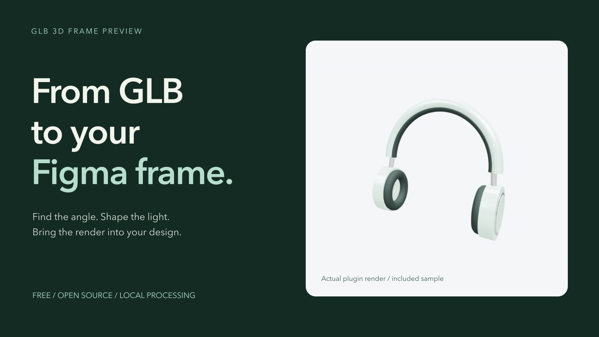

# GLB 3D Frame Preview

Preview local `.glb` files inside a Figma plugin, tune WebGL / Three.js rendering parameters, and sync the current render into a selected Figma frame.

[Open in Figma Community](https://www.figma.com/community/plugin/1689584566677007084)



Create product presentations and explore camera angles, materials, and lighting
without leaving Figma. Free, open source, and processed locally.

## Use in Figma

1. Open the [Community plugin page](https://www.figma.com/community/plugin/1689584566677007084) and choose **Open in Figma**.
2. Run **GLB 3D Frame Preview** and choose **Try sample model**, or import a local `.glb` file.
3. Choose **Create New Frame**, or select a frame and choose **Use Selected Frame**.
4. Adjust the view and lighting, then choose **Sync Frame**. Enable **Live sync** if you want automatic updates while you work.

Version 1.2.0 is available as Community Version 3, published October 23, 2026.
Sync replaces the target frame's fills; use a dedicated frame for the render.

### What's New in 1.2

Version 1.2.0 organizes settings into **Look**, **Position**, **Light**,
and **More**, keeps **Sync Frame** visible, and leaves **Live sync** off until
you enable it. Switching the target frame turns Live sync off again.
Use **More > Settings JSON** to copy, download, or reuse a preset. JSON presets
do not contain the model or export a PNG; use **Sync Frame** for the render.

[Download the original sample model](examples/studio-headphones.glb) and follow
the [sample walkthrough](examples/README.md).

Prebuilt plugin and sample ZIPs are available from
[GitHub Releases](https://github.com/khan-tw/glb-3d-viewer-figma-plugin/releases).
See the [ZIP installation guide](docs/INSTALL_FROM_ZIP.md) for local installation.

[Open the Figma playground](https://www.figma.com/design/CxW8FvI0JErG3TNxrc3YGm/GLB-3D-Frame-Preview---Playground?node-id=1-5)
for editable instructions, real example renders, and a separate practice frame.
Duplicate the file into your drafts to try it yourself.

No account or API key is required by the plugin. Models are processed locally.

### Run From Source

1. Open Figma Desktop.
2. Go to Plugins > Development > Import plugin from manifest.
3. Choose `manifest.json` from this folder.
4. Run `GLB 3D Frame Preview` from Plugins > Development.

## Features

- Load a local `.glb` file.
- Load Draco-compressed GLB files exported from Blender.
- Rotate the model by dragging the preview.
- Zoom with the mouse wheel.
- Adjust model scale and X/Y/Z rotation.
- Adjust camera FOV.
- Adjust key, ambient, hemisphere, fill, and rim lighting.
- Tune renderer exposure, shadows, fog, and studio environment intensity.
- Switch material preview modes: original, clay, normal, and wireframe.
- Choose transparent, dark, light, Figma gray, or warm backgrounds.
- Hide detected model floor / shadow meshes when needed.
- Live-sync the current WebGL render into a selected Figma frame.
- Resize the plugin window with compact/default/wide presets or the bottom-right drag handle.
- Copy or download JSON settings for engineering reference.

The Figma canvas preview is a synchronized PNG render. Figma plugin APIs do not allow a live WebGL runtime to be embedded directly inside a Figma frame, so the plugin updates the frame image fill whenever the view or parameters change.

## Exported JSON shape

```json
{
  "fileName": "model.glb",
  "fov": 45,
  "camera": {
    "position": { "x": 0, "y": 1.2, "z": 4 },
    "target": { "x": 0, "y": 0, "z": 0 }
  },
  "model": {
    "scale": 1,
    "rotation": { "x": 0, "y": 0, "z": 0 }
  },
  "light": {
    "type": "directional",
    "intensity": 3,
    "color": "#ffffff",
    "position": { "x": 3, "y": 4, "z": 5 }
  },
  "ambientLight": {
    "intensity": 1.2
  },
  "hemisphereLight": {
    "enabled": true,
    "intensity": 0.8,
    "skyColor": "#ffffff",
    "groundColor": "#59616b"
  },
  "fillLight": {
    "enabled": true,
    "intensity": 1.4,
    "color": "#dcecff",
    "position": { "x": -4, "y": 2, "z": 3 }
  },
  "rimLight": {
    "enabled": true,
    "intensity": 1,
    "color": "#ffffff",
    "position": { "x": 0, "y": 3, "z": -5 }
  },
  "environment": {
    "mode": "studio",
    "intensity": 0.9
  },
  "material": {
    "mode": "original"
  },
  "fog": {
    "enabled": false,
    "color": "#111315",
    "near": 6,
    "far": 14
  },
  "renderer": {
    "toneMapping": "ACESFilmicToneMapping",
    "toneMappingExposure": 1.25,
    "outputColorSpace": "srgb",
    "backgroundMode": "transparent",
    "background": "transparent",
    "showFloor": true,
    "shadows": false
  }
}
```

## Development

```bash
npm install
npm run typecheck
npm run build
npm test
```

The Figma manifest points to the built files in `dist/`.

### Prepare Local Release Packages

Run `npm run release:prepare` to check types, run tests, rebuild, and create
verified plugin/sample ZIPs with SHA-256 checksums under the ignored `releases/`
directory. Packaging does not push code, create a GitHub release, update Figma
Community, or publish promotional drafts. Candidate builds must be reviewed
before publication.

## Support

Use GitHub issues for bug reports and feature requests:

`https://github.com/khan-tw/glb-3d-viewer-figma-plugin/issues`

## Privacy

This plugin does not make external network requests. It works with local `.glb` files. Sync writes a rendered PNG and viewer settings (including the file name) into your Figma document; that content follows the document's sharing permissions. Exported settings are also saved in Figma client storage. The original GLB is not uploaded.

Full details are available in `PRIVACY.md`.

## License

MIT
